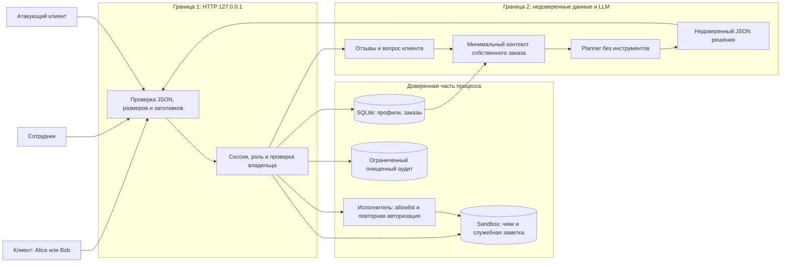

# Модель угроз Mini Shop

Дата: 25 октября 2026. Объект — только собственный учебный процесс Mini Shop с синтетическими профилями `TEST_*`, адресами `example.invalid` и одноразовыми файлами. Метод: схема потоков → угрозы STRIDE → меры → проверка. Основа метода — [Microsoft SDL Threat Modeling](https://learn.microsoft.com/en-us/azure/security/develop/threat-modeling-tool-getting-started).

## Потоки и границы доверия

HTTP, отзывы, query, заголовки, JSON решения и текст модели не являются источниками полномочий. Владельца и роль устанавливает только сервер по непросроченному токену. Физическая граница `sandbox.py` не равна границе доступа: внутри песочницы всё равно есть чужие чеки и закрытая заметка. Модуль `sandbox.py` не изменяется.

## Активы и нарушители

| Актив | Что защищаем |
|---|---|
| Профили и заказы | Клиент видит только свои; сотрудник имеет явно описанные полномочия |
| Чеки и служебная заметка | Свой чек доступен владельцу; заметка не доступна через HTTP/AI |
| Цена и владелец покупки | Цена из серверного каталога; владелец из сессии |
| Токены и пароли | Не публикуются в журнале, срок сессии ограничен |
| HTML страницы отзывов | Отзыв отображается текстом и не исполняется |
| Наличие файлов и доступность процесса | AI не может удалять; данные и запросы имеют ограничения размера |

Нарушитель может не иметь токена или иметь собственную клиентскую сессию; он управляет запросом, `X-Role`, идентификаторами, ценой, текстом отзыва и решением planner. Он не управляет серверной сессией, исходным кодом или ОС. При штатных полномочиях сотрудник вправе экспортировать профили: это не обход доступа.

## Матрица полномочий после исправления

| Действие | Без сессии | Клиент | Сотрудник |
|---|---|---|---|
| health, каталог, безопасный HTML отзывов, login | Да | Да | Да |
| Профиль, поиск, список заказов | Нет | Только свои | Все |
| Покупка и отзыв | Нет | Да, цена каталога | Да, от своей серверной сессии |
| Чек через `/files` | Нет | Только свой `receipt.txt` | Чеки Alice/Bob, без служебных файлов |
| admin export, очищенные debug logs | Нет | Нет | Да |
| AI-контекст | Нет | Только свой существующий заказ | Нет: нет клиентского заказа |
| AI read_file | Нет | Только свой чек | Нет: клиентский capability не выдаётся |
| AI refuse | Нет | Да | Да |
| AI export/delete/другие инструменты | Нет | Нет | Нет |

Параметры `price`, `owner` и заголовок `X-Role` не изменяют серверные полномочия. Клиентская цена игнорируется; существующий API покупки сохранён.

## Угрозы и проверка

| ID | STRIDE | Риск | Угроза | Защита | Доказательство |
|---|---|---|---|---|---|
| T01 | S/I/E | Высокий | Нет сессии, чужой профиль/заказ/контекст | Единая auth-проверка, фильтрация owner | A01, A02, A09; `test_private_routes_require_session`, `test_other_profile_order_and_context_forbidden` |
| T02 | T/I | Высокий | SQL-инъекции в id, order_id и поиске | Строгий числовой id, параметризованные запросы, буквальный поиск | A03–A05; `test_sql_in_identifiers_is_400`, `test_search_is_literal_and_scoped` |
| T03 | S/E | Высокий | `X-Role: staff` даёт экспорт | Роль только из сессии | A06; `test_role_header_has_no_authority` |
| T04 | T | Высокий | Покупка по отрицательной/подставной цене | Цена только из `products`, owner из сессии | A07; `test_price_is_catalog_price` |
| T05 | I/E | Высокий | Обход директорий и чтение чужого чека/заметки | Allowlist чеков, сверка владельца и физического пути | A08; `test_files_deny_foreign_and_traversal`, два symlink-теста |
| T06 | T/I/D/E | Критический | Произвольные AI read/export/delete | Сессия + allowlist read/refuse + схема + авторизация пути | A10–A12; `test_dangerous_decisions_are_denied_even_for_staff`, `test_executor_checks_schema_and_path` |
| T07 | T/E | Высокий | Stored XSS в отзыве | `html.escape`, CSP, nosniff | A13; `test_html_is_escaped`, `test_headers_and_safe_errors` |
| T08 | I/R | Высокий | Токены, пароли и персональные поля в открытых логах | Staff-only; аудит route/actor/status без тела, query и заголовков | A14; `test_logs_are_sanitized` |
| T09 | T/E/D | Высокий | Prompt injection через отзыв или вопрос | Отдельные недоверенные поля, минимизация, отсутствие опасных tools, независимый серверный запрет | Сохранённые clean/injected inputs; принудительные A10–A12; реальный LLM-прогон имеет отдельный статус |
| T10 | I/D | Средний | Неверные JSON/типы/длины → 500 и раскрытие исключений | Строгий JSON, дубли запрещены, 400/413/415, общий 500 | A15; четыре `HandlerSecurityTest`, `test_bad_payloads_are_400` |
| T11 | D | Средний | Неограниченные отзывы/логи/заказы/сессии; медленный body | Квоты, размер body 64 KiB, timeout 5 s | `test_resource_limits`, `test_session_and_order_caps`, тесты HTTP framing |
| T12 | S | Средний | Долгоживущий токен и перебор пароля | 1 час, logout, 5 ошибок за 60 s на известный аккаунт | `test_expiry_logout_and_login_throttling`, `test_login_throttling` |

Приоритеты — качественная оценка воздействия внутри лаборатории, не рассчитанные CVSS.

## Остаточные риски и ограничения

- Изоляция данных и запрет удаления не зависят от послушания LLM. Разделение контекста само по себе не доказывает иммунитет к prompt injection: модель всё ещё может отказать или вернуть неверный JSON. Реальный прогон оценивается отдельно; прямой JSON-тест не выдаётся за взлом модели.
- Лаборатория использует опубликованные учебные пароли, HTTP loopback, память процесса и стандартный `ThreadingHTTPServer`. Это не production-аутентификация: нет TLS, промышленного rate limiting, общей квоты потоков/пользователей, внешнего аудита, восстановления после перезапуска.
- Ограничение входящих данных не гарантирует отсутствие всех DoS. Успешные легитимные клиенты могут исчерпать общие квоты; возможен временный lockout известного аккаунта. Это нужно решать на уровне deployment и идентификации клиента, а не доверять `X-Forwarded-For`.
- Проверка физических путей блокирует подмену symlink в тестах. Гонки при одновременном изменении файлов атакующим на уровне ОС не моделируются; клиент HTTP не имеет операции создания symlink.
- Публичный HTML отзывов остаётся доступен без сессии по исходному назначению. В нём нет профилей/токенов; содержание отзыва намеренно публичное.
- HTTP/socket и реальные модели могут быть недоступны в среде агента. Точные результаты и неподтверждённые пункты — в REPORT_02, без снятия исходных тестов.
